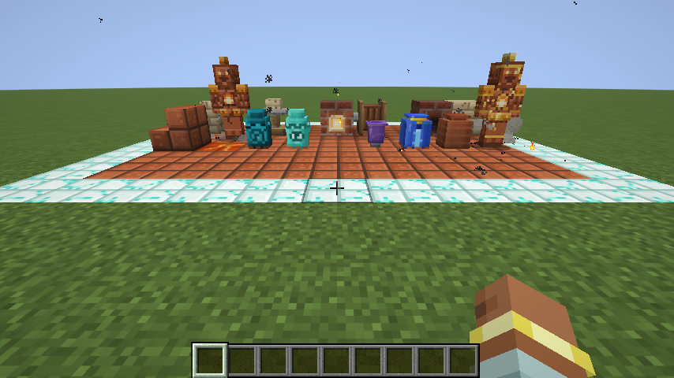
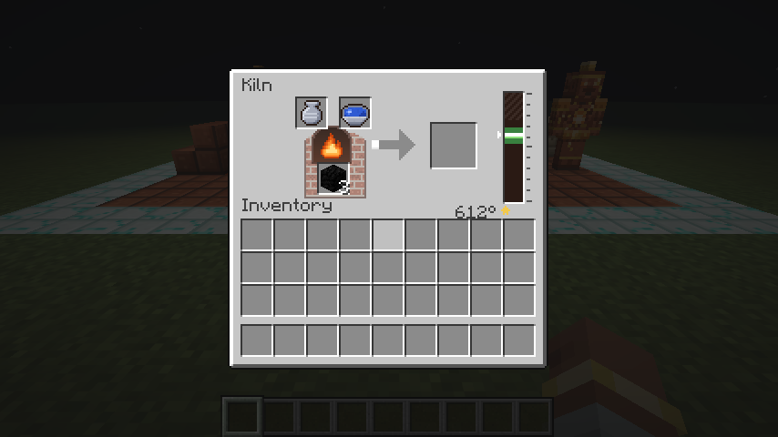
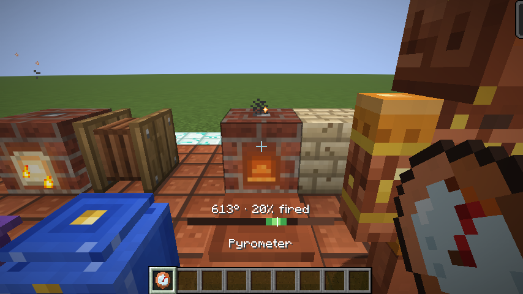
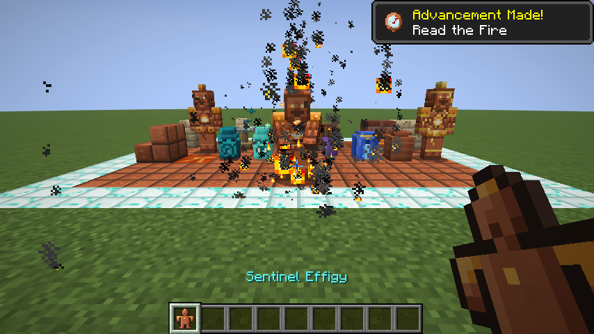
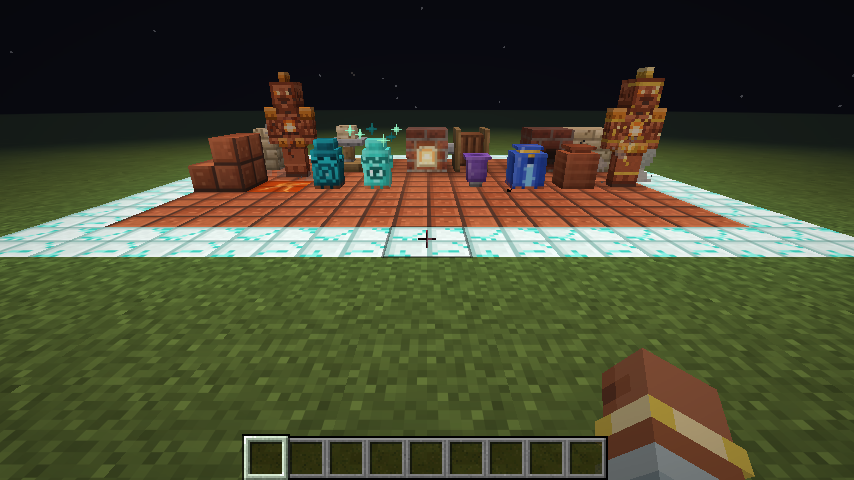

# Fireclay

*Throw it, glaze it, fire it just right. Clay remembers the fire.*

Fireclay is a pottery and kiln mod for **Minecraft 26.3** on **Fabric**. You throw greenware on a potter's wheel, mix glazes from minerals, and fire them in a kiln whose heat you have to manage by hand or with redstone. Fire a piece inside its window and you get a working ceramic. Hold the heat in the sweet spot and you get a signed **Masterwork**. Overshoot and it cracks.



## Screenshots

| | |
|---|---|
|  |  |
| **Kiln screen:** greenware, glaze, fuel, and the heat gauge with the recipe's window and sweet spot | **Pyrometer:** look at a kiln to read its heat and progress without opening it |
|  |  |
| **Sentinel Awakening:** a fired effigy stands up as a guardian | **At night:** the same showcase after dark |

These were captured by the client gametest. Every CI run takes the same shots again and uploads them as the `fireclay-screenshots` artifact.

## Requirements

| | |
|---|---|
| Minecraft | 26.3 |
| Fabric Loader | 0.19.5 or newer |
| Fabric API | 0.162.0+26.3 |
| Java | 25 |

## The loop

```
dig clay ─▶ throw greenware on the wheel ─▶ mix a slip from a mineral ─▶ fire in the kiln
   ▲                                                                        │
   │            in window → functional ceramic (sweet spot → Masterwork)    │
   └── cracks → Kiln Shards → Grog → Fireclay → Kiln Lining (hotter kiln) ◀─┘
```

Placing your first Potter's Wheel gives you **The Potter's Primer**, a written book that explains the rest in game.

### The kiln

The kiln runs a heat simulation every tick:

- **Fuel.** Fuel sets how hot the kiln settles. Wood settles around 320°, coal 520°, coal blocks 620°, lava 670° and blaze rods hit the 750° cap. The kiln uses its own fuel table and ignores vanilla burn times.
- **Firing window.** Each recipe has one. A piece only progresses while the heat is inside it.
- **Overheating.** If the kiln stays above the window too long, the piece cracks into Kiln Shards.
- **Sweet spot.** Spend at least 90% of the firing in the middle 40% of the window and an eligible piece comes out as a Masterwork, signed with your name.
- **Bellows.** A pump adds +35° at once and burns a little extra fuel. Bellows work by hand or by redstone pulse.
- **Damper.** Redstone into the back or top face opens it, and the kiln cools fast.
- **Comparator.** It reads the heat relative to the current recipe's window, so one comparator thermostat works for every recipe.
- **Kiln Lining.** Made from fireclay, a lining raises the cap to 1000° for the high-fire recipes.

### What you can make

| Glaze | Nature | Piece |
|---|---|---|
| none | holds | **Storage Jar**: a portable 9-slot jar that keeps its contents when broken |
| none | holds | **Fired Tiles**, stairs and slabs |
| Glow ink | shines | **Lumen Tiles** |
| Lapis | remembers | **Memory Jar**: stores experience |
| Amethyst | listens | **Sentry Chime**: emits redstone when hostile mobs come near, stronger as they get closer |
| Glow ink | keeps vigil | **Vigil Urn**: a light that pushes hostile mobs away |
| Blaze | holds heat | **Ember Tile**: smelts items dropped on it |
| Echo | holds a soul | **Reliquary Urn**: catches your inventory when you die |
| Blaze, on fireclay | holds a will | **Terracotta Sentinel**: a guardian that awakens from a fired effigy |

The **Pyrometer** shows a kiln's heat gauge on your HUD while you look at the kiln. The mod also adds an 18-step advancement tab.

### Commands and game rules

- `/fireclay` (needs moderator permission):
  - `kiln <pos> info|heat <value>`: inspect a kiln or set its heat.
  - `primer`: hand out a primer.
  - `record`: show a player's potter record.
- Game rules:
  - `fireclay:kiln_crack_grace` (default 40 ticks): how long a piece can stay overheated before it cracks.
  - `fireclay:reliquary_urns` (default on): turns Reliquary Urns on or off.
  - `fireclay:max_sentinels_per_player` (default 4): caps Sentinels per player.

## Building

```sh
./gradlew build              # mod jar in build/libs/
./gradlew runGameTest        # server gametests
./gradlew runClientGameTest  # client gametest (takes screenshots in build/run/clientGameTest/screenshots)
```

CI (`.github/workflows/build.yml`) builds the mod and runs both gametest suites on every push.

## Project layout

| Path | What it holds |
|---|---|
| `src/main/java` | Common code: registries, kiln, blocks, entity, components, networking, commands |
| `src/client/java` | Client code: kiln screen, sentinel model and renderer, pyrometer HUD, particles |
| `src/gametest/java` | Server gametests and the client gametest |
| `src/main/resources` | Assets and data, all generated by the scripts in `tools/` |
| `tools/*.py` | Deterministic Python generators: textures (PIL), models, blockstates, sounds (ffmpeg), recipes, loot tables, tags, advancements, lang |
| `docs/` | `design.md` (full design), `contract.md` (ids and names shared by code and assets), `api.md` (cross-feature Java API) |

To regenerate the assets and data, run from the repository root:

```sh
PYTHONPATH=tools python3 tools/gen_blocks_core.py   # likewise gen_blocks_ceramics, gen_items, gen_entity_gui, gen_sounds
python3 tools/gen_data.py && python3 tools/gen_lang.py
```

## License

MIT. See [LICENSE](LICENSE).
